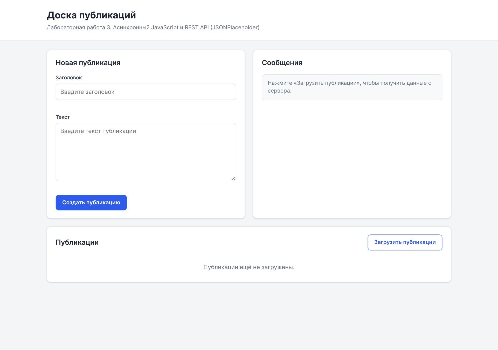
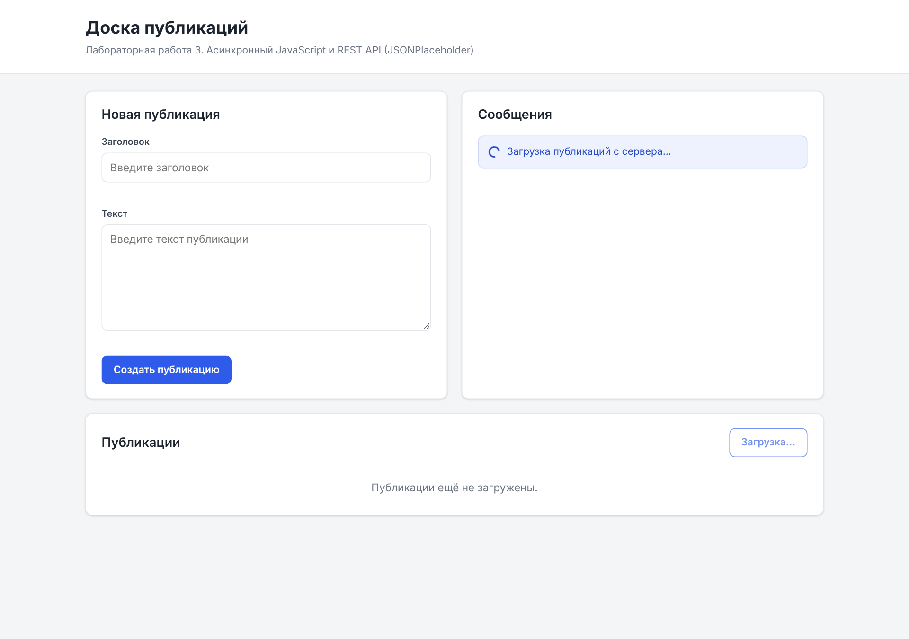
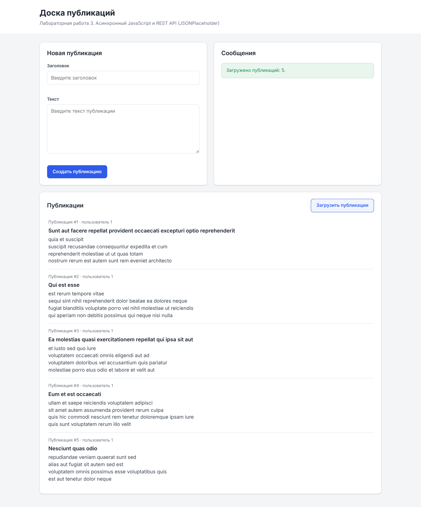
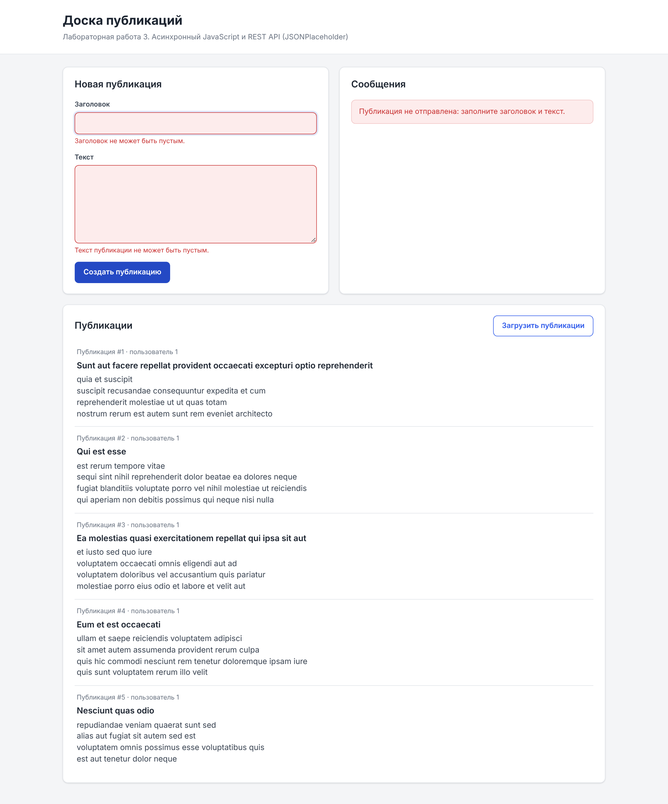
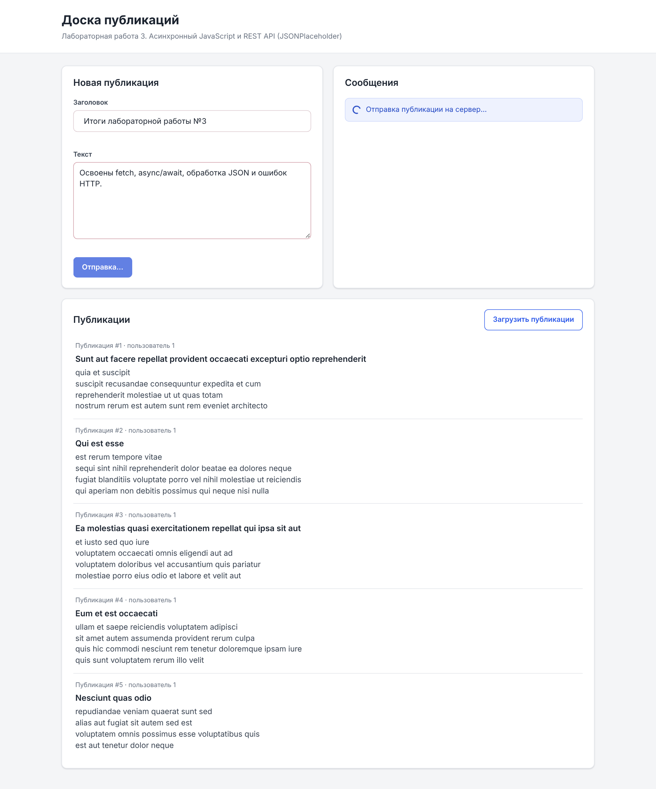
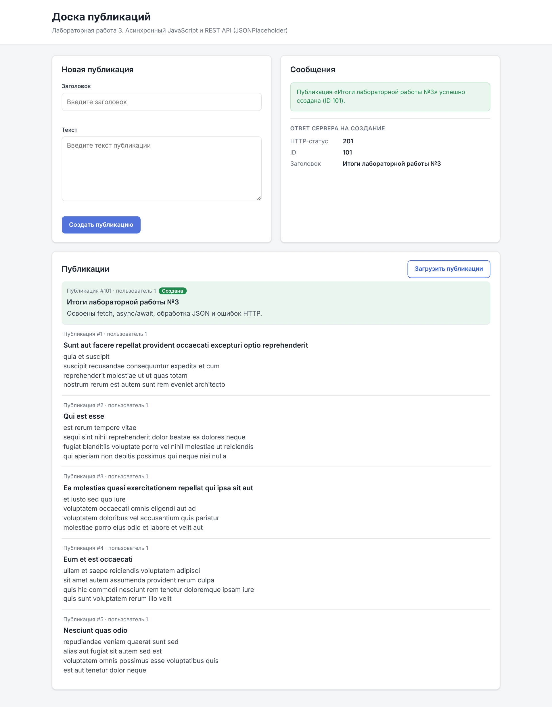
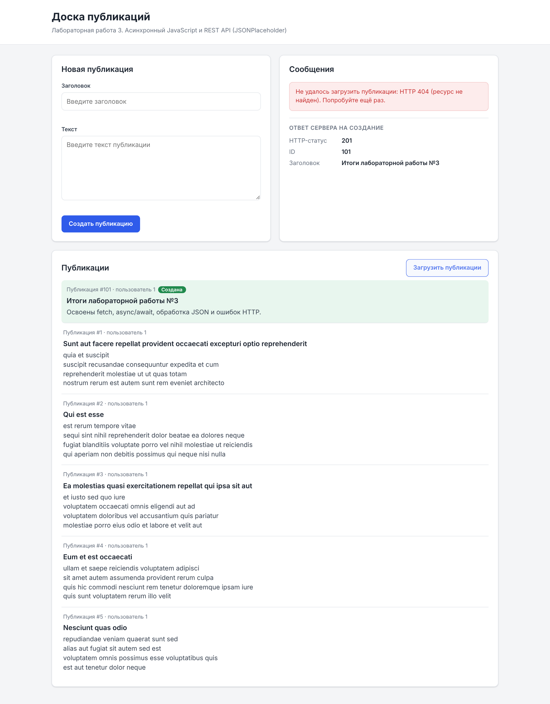
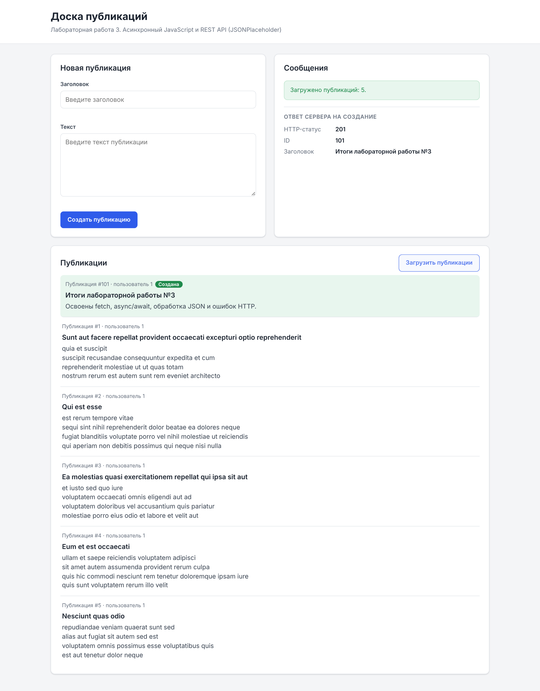
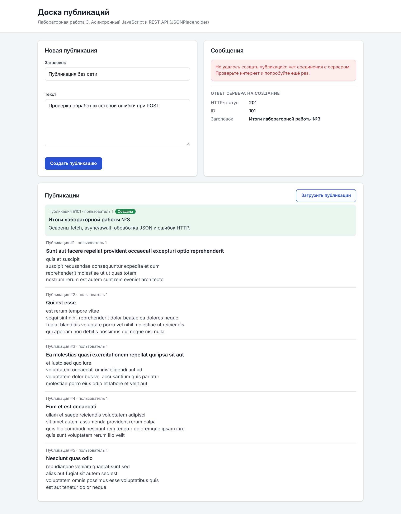

# Лабораторная работа 3. Асинхронный JavaScript и REST API

**Студент:** Шокуев Имран Русланович  
**Группа:** БПИ-23-РП-3  
**Приложение:** «Доска публикаций» — загрузка и создание публикаций через REST API JSONPlaceholder (HTML, CSS, vanilla JavaScript).

**Демо:** https://shokuy.github.io/misis-lab3-posts-board/

## Структура проекта

```
misis-lab3-posts-board/
├── index.html          разметка: форма, область сообщений, список публикаций
├── style.css           оформление, состояния загрузки, успеха и ошибки
├── app.js              логика: fetch, async/await, валидация, вывод через DOM
├── README.md           описание и результаты проверки
├── screenshots/        скриншоты работы программы
└── tests/
    └── run_checks.py   автоматическая проверка сценариев (Playwright)
```

## Запуск

1. Распаковать архив.
2. Открыть `index.html` в браузере (Chrome, Firefox, Edge, Safari). Нужен доступ в интернет к `jsonplaceholder.typicode.com`.

Также можно запустить через локальный сервер: `python -m http.server` в папке проекта, затем открыть `http://localhost:8000`.

Автотест (необязательно): `pip install playwright requests && playwright install chromium`, затем `python tests/run_checks.py . screenshots`.

## Реализация

| Требование | Реализация |
|---|---|
| 1. Интерфейс | Кнопка «Загрузить публикации», список публикаций, форма с подписанными полями «Заголовок» и «Текст», кнопка «Создать публикацию», область «Сообщения». Оформление на CSS Grid, адаптивная вёрстка. |
| 2. GET | `handleLoadPosts` запрашивает `https://jsonplaceholder.typicode.com/posts?_limit=5` через `fetch` + `async/await`. Проверяются `response.ok` и формат ответа (массив), JSON читается через `response.json()`. Для каждой публикации создаются элементы `<li>`, `<h3>`, `<p>`, текст выводится через `textContent`. |
| 3. POST | Обработчик `submit` подключён через `addEventListener`, вызывается `preventDefault()`. Перед отправкой поля обрезаются через `trim()`; если поле пустое, под ним выводится ошибка и запрос не отправляется. Отправляется `{ title, body, userId: 1 }` в формате JSON с заголовком `Content-Type: application/json`. После проверки `response.ok` выводятся HTTP-статус, ID и заголовок из ответа, сообщение об успехе; созданная публикация добавляется в начало списка с меткой «Создана». |
| 4. Загрузка и ошибки | Пока идёт запрос, показывается сообщение со спиннером («Загрузка…» / «Отправка…»), кнопка блокируется, чтобы не было повторных запросов. Ошибки обрабатываются через `try/catch/finally`: неуспешный HTTP-ответ (404 и др.) приводит к `HttpError`, сетевой сбой — к `TypeError`, превышение 10 с — к `TimeoutError` (`AbortController`), некорректный JSON — к `SyntaxError`. Для каждого случая выводится понятное сообщение. В `finally` кнопка снова становится активной для повторной попытки. При ошибке POST введённые данные не стираются. |

### Устройство кода (`app.js`)

- Настройки: `API_BASE`, `POSTS_URL`, `GET_POSTS_URL` (для проверки 404 меняется одна строка), `REQUEST_TIMEOUT_MS`.
- Сеть: `requestJson` (общая обёртка над `fetch`: `response.ok`, JSON, таймаут), `fetchPosts`, `sendPost`.
- Ошибки: классы `HttpError` и `TimeoutError`, функция `getErrorMessage`.
- Интерфейс: `showMessage`, `setButtonBusy`, `createPostElement`, `renderPosts`, `renderCreatedResult`.
- Валидация: `validatePostForm`, `setFieldError`, `clearFormErrors`.
- Обработчики: `handleLoadPosts`, `handleCreatePost`, `handleFieldInput`.

## Результаты проверки

Все проверки выполнены на **реальном** сервере JSONPlaceholder. Скрипт `tests/run_checks.py` открывает страницу в Chromium и только задерживает или обрывает запросы, когда это нужно для конкретного сценария. **Пройдено 34 из 34 проверок**, ошибок JavaScript нет.

| Проверка из задания | Результат |
|---|---|
| «Загрузить публикации» → 5 записей | Во время запроса показаны «Загрузка публикаций с сервера…» и заблокированная кнопка. Получен HTTP 200, выведено 5 публикаций с заголовком и текстом, сообщение «Загружено публикаций: 5». |
| Пустые поля / одни пробелы → ошибка, запрос не отправляется | Под обоими полями выводятся сообщения, в области сообщений — «Публикация не отправлена…». Сетевых запросов не было. |
| Корректные данные → успешный ответ | Отправлен POST с `Content-Type: application/json` и телом `{title, body, userId: 1}` (пробелы по краям удалены). Получен HTTP 201: на странице статус 201, ID 101, заголовок, сообщение об успехе; публикация появилась в начале списка. |
| GET на `/postz` (404) → ошибка, повторная попытка | Реальный ответ HTTP 404, сообщение «Не удалось загрузить публикации: HTTP 404 (ресурс не найден). Попробуйте ещё раз.», кнопка активна. После восстановления адреса повторная загрузка прошла успешно. |
| Дополнительно: сетевой сбой | При обрыве соединения для GET и POST выводится «нет соединения с сервером», кнопки снова активны, данные формы сохранены. |

Примечание: JSONPlaceholder только имитирует создание записи, поэтому любая новая публикация получает ID 101 и на сервере не сохраняется.

## Скриншоты

**1. Начальное состояние**


**2. Загрузка публикаций (запрос выполняется)**


**3. Загружено 5 публикаций**


**4. Валидация: пустые поля и пробелы**


**5. Отправка публикации (запрос выполняется)**


**6. Публикация создана (HTTP 201, ID 101)**


**7. Ошибка 404 при GET на /postz**


**8. Повторная попытка после восстановления адреса**


**9. Сетевой сбой**

